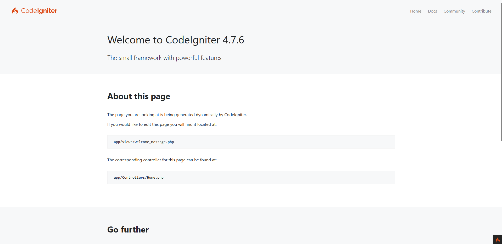
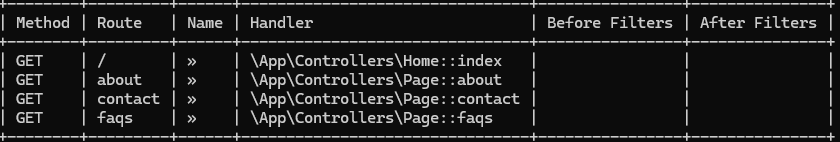
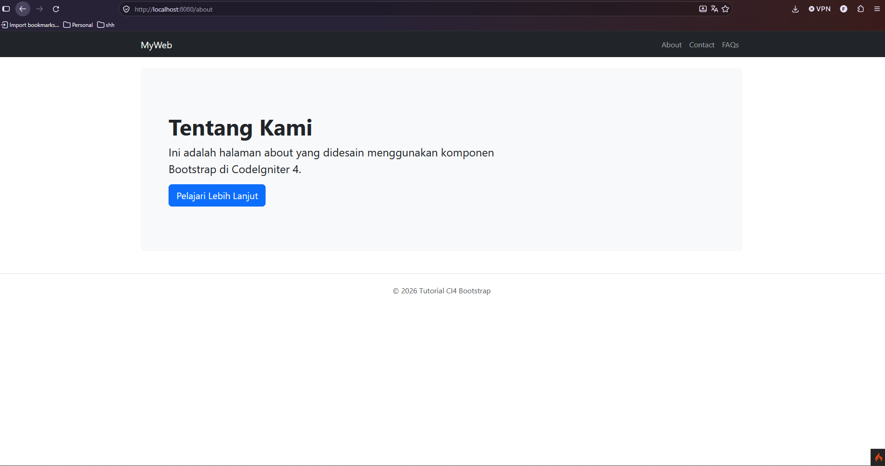
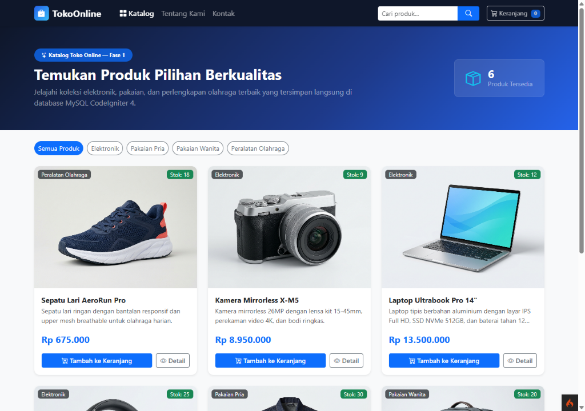
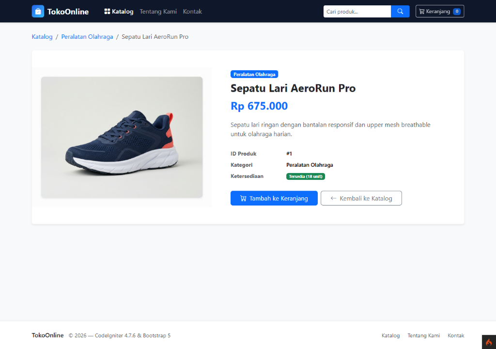
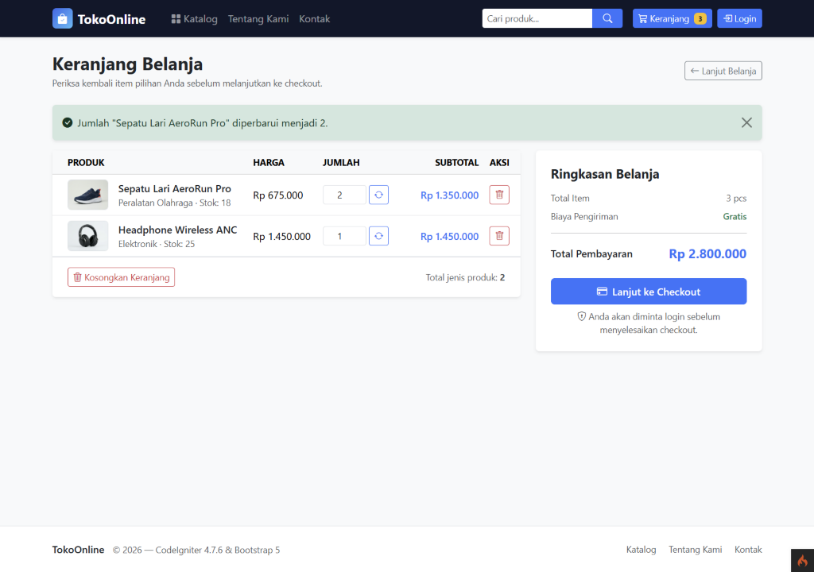
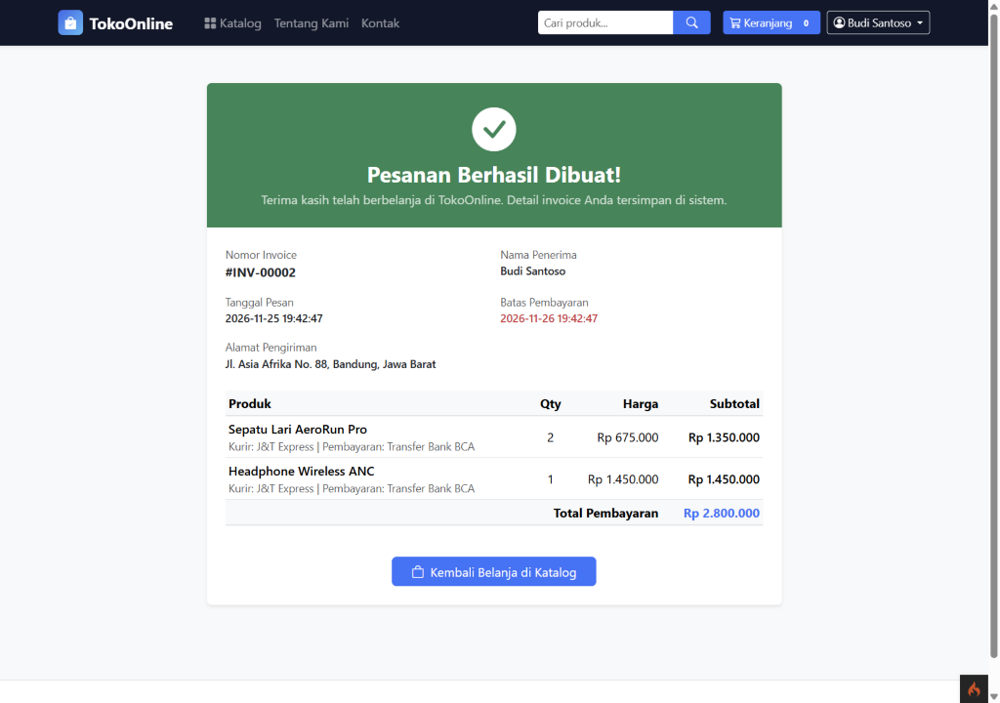
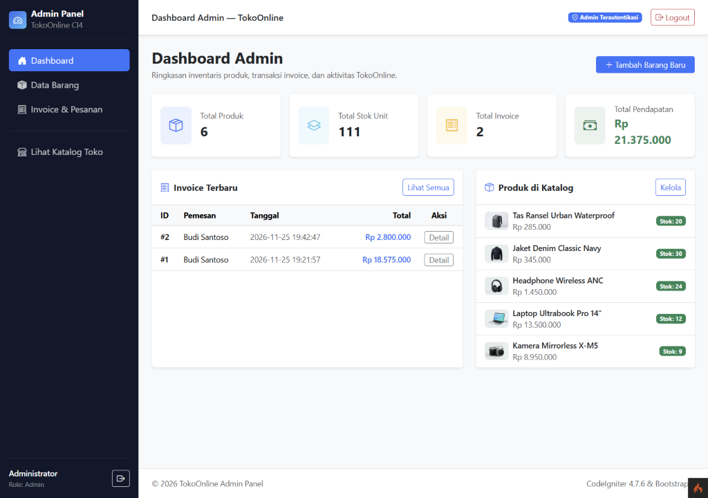
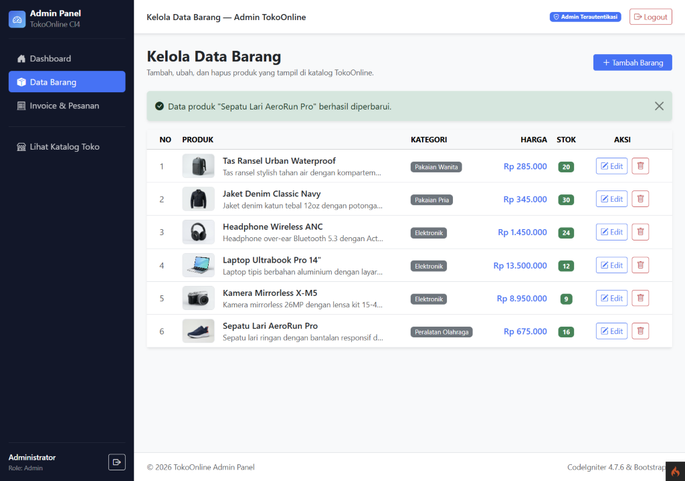
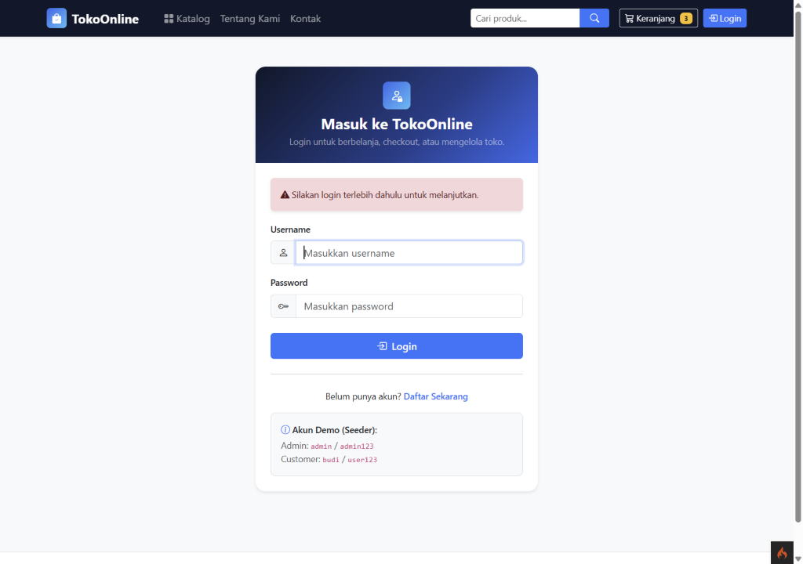

# MVC-Code-Igniter

# Laporan Praktikum: Instalasi & Pengembangan Web Dasar dengan CodeIgniter 4

---

## 1. Persiapan Lingkungan Pengembangan (XAMPP & PHP)

### 1.1 Instalasi XAMPP
Untuk menjalankan CodeIgniter 4 secara lokal, diperlukan *runtime* PHP yang didapatkan melalui paket bundling **XAMPP** (PHP 8.2.12). 
* **Kendala:** Pengunduhan melalui browser maupun `curl` dari server SourceForge mengalami pembatasan *bandwidth* (~60–80 KB/detik).
* **Solusi:** Instalasi dilakukan melalui terminal menggunakan *Windows Package Manager* (`winget`) agar mendapatkan jalur CDN resmi yang lebih cepat:
  ```powershell
  winget install ApacheFriends.Xampp.8.2
  ```


### 1.2 Konfigurasi Environment Variables (Path) & Ekstensi PHP
1. Menambahkan direktori `C:\xampp\php` ke dalam **System Environment Variables (`Path`)** agar perintah `php` dapat diakses secara global melalui terminal.
2. Melakukan *restart* terminal dan memverifikasi instalasi dengan perintah:
   ```powershell
   php -v
   ```
3. Mengaktifkan ekstensi wajib CodeIgniter 4 pada file `C:\xampp\php\php.ini` dengan menghapus tanda titik koma (`;`):
   ```ini
   extension=intl
   extension=mbstring
   extension=curl
   ```


---

## 2. Konfigurasi Awal Proyek CodeIgniter 4

Proyek menggunakan **CodeIgniter v4.7.6** yang diunduh langsung dari situs resmi dan diekstrak ke direktori lokal.

1. Menyalin template konfigurasi `env` menjadi `.env`:
   ```cmd
   copy env .env
   ```
2. Mengubah mode lingkungan menjadi `development` agar pesan *error* dan *debugging* ditampilkan secara rinci saat proses pengembangan, serta mengatur `app.baseURL`:
   ```ini
   CI_ENVIRONMENT = development
   app.baseURL = 'http://localhost:8080/'
   ```
3. Menjalankan server pengembangan bawaan melalui CLI Spark:
   ```bash
   php spark serve
   ```



---

## 3. Implementasi Controller dan Routing

### 3.1 Pembuatan Controller `Page.php`
Membuat controller baru pada `app/Controllers/Page.php` untuk menangani beberapa halaman statis (`about`, `contact`, `faqs`, `tos`).

```php
<?php namespace App\Controllers;

class Page extends BaseController
{
    public function about()
    {
        echo "about page";
    }

    public function contact()
    {
        echo "contact page";
    }

    public function faqs()
    {
        echo "Faqs page";
    }

    public function tos()
    {
        echo "Halaman Term of Service";
    }
}
```

### 3.2 Penanganan Kendala Routing (Auto Route vs Defined Routes)
* **Kendala:** Pada CodeIgniter v4.7.6, fitur *Auto Routing (Legacy)* telah dihapus demi keamanan. Sistem menerapkan *Auto Routing (Improved)* yang mewajibkan awalan metode HTTP (seperti `getTos()`) serta melarang akses *auto route* pada controller yang sudah didaftarkan di *Defined Routes* (`Cannot access the controller in Defined Routes`).
* **Solusi:** Mendaftarkan seluruh rute halaman secara eksplisit di dalam file `app/Config/Routes.php`:

```php
<?php

use CodeIgniter\Router\RouteCollection;

/** @var RouteCollection $routes */
$routes->get('/', 'Home::index');
$routes->get('/about', 'Page::about');
$routes->get('/contact', 'Page::contact');
$routes->get('/faqs', 'Page::faqs');
```



---

## 4. Integrasi Bootstrap 5 dan Modular View

Untuk membangun antarmuka yang responsif tanpa mengulang kode HTML pada setiap halaman, struktur tampilan dipisah menjadi komponen `header`, konten utama, dan `footer` di dalam direktori `app/Views/`.

### 4.1 Pembaruan Controller `Page.php`
Mengubah *output* masing-masing *method* pada `app/Controllers/Page.php` dari `echo` menjadi pemanggilan fungsi `view()`:

```php
<?php

namespace App\Controllers;

class Page extends BaseController
{
    public function index()
    {
        return view('welcome_message');
    }

    public function about()
    {
        return view('about');
    }

    public function contact()
    {
        return view('contact');
    }

    public function faqs()
    {
        return view('faqs');
    }
}
```

### 4.2 Pembuatan Template Layout (`header.php` & `footer.php`)
Membuat folder `app/Views/layout/` berisi dua file template utama menggunakan **Bootstrap 5.3.3 CDN**:

**`app/Views/layout/header.php`**
```html
<!DOCTYPE html>
<html lang="id">
<head>
    <meta charset="UTF-8">
    <meta name="viewport" content="width=device-width, initial-scale=1.0">
    <title>Website CodeIgniter 4</title>
    <link href="[https://cdn.jsdelivr.net/npm/bootstrap@5.3.3/dist/css/bootstrap.min.css](https://cdn.jsdelivr.net/npm/bootstrap@5.3.3/dist/css/bootstrap.min.css)" rel="stylesheet">
</head>
<body>
    <nav class="navbar navbar-expand-lg navbar-dark bg-dark">
        <div class="container">
            <a class="navbar-brand" href="<?= base_url() ?>">MyWeb</a>
            <div class="navbar-nav">
                <a class="nav-link" href="<?= base_url('about') ?>">About</a>
                <a class="nav-link" href="<?= base_url('contact') ?>">Contact</a>
                <a class="nav-link" href="<?= base_url('faqs') ?>">FAQs</a>
            </div>
        </div>
    </nav>
    <div class="container mt-4">
```

**`app/Views/layout/footer.php`**
```html
    </div>
    <footer class="text-center py-4 text-muted mt-5 border-top">
        <p>&copy; <?= date('Y') ?> Tutorial CI4 Bootstrap</p>
    </footer>

    <script src="[https://cdn.jsdelivr.net/npm/bootstrap@5.3.3/dist/js/bootstrap.bundle.min.js](https://cdn.jsdelivr.net/npm/bootstrap@5.3.3/dist/js/bootstrap.bundle.min.js)"></script>
</body>
</html>
```

### 4.3 Pembuatan File View Halaman & Penyelesaian `ViewException`
* **Kendala:** Muncul pesan error `CodeIgniter\View\Exceptions\ViewException: Invalid file: "about.php"` dan `"contact.php"` karena file view belum diletakkan langsung di dalam root direktori `app/Views/`.
* **Solusi:** Memastikan file `about.php` dan berada tepat di jalur `app/Views/` (sejajar dengan folder `layout`) dengan ekstensi `.php` yang valid.

**`app/Views/about.php`**
```php
<?= view('layout/header') ?>

<div class="p-5 mb-4 bg-light rounded-3">
    <div class="container-fluid py-5">
        <h1 class="display-5 fw-bold">Tentang Kami</h1>
        <p class="col-md-8 fs-4">Ini adalah halaman about yang didesain menggunakan komponen Bootstrap di CodeIgniter 4.</p>
        <button class="btn btn-primary btn-lg" type="button">Pelajari Lebih Lanjut</button>
    </div>
</div>

<?= view('layout/footer') ?>
```



---

## 5. Kesimpulan
Seluruh proses konfigurasi lingkungan lokal (PHP 8.2.12 via XAMPP), pengaturan *routing* eksplisit pada CodeIgniter v4.7.6, serta pemisahan tata letak antarmuka (*modular view*) menggunakan Bootstrap 5 berhasil diimplementasikan dan dijalankan melalui server lokal `http://localhost:8080`.

# Laporan Pengembangan Aplikasi Toko Online Berbasis CodeIgniter 4

---

## Pendahuluan

Dokumen ini menjelaskan langkah-langkah pengembangan aplikasi web **Toko Online** secara bertahap menggunakan arsitektur **Model-View-Controller (MVC)** pada framework **CodeIgniter 4**. Aplikasi mencakup katalog produk dinamis, keranjang belanja berbasis session, proses checkout transaksional, panel admin (dashboard, CRUD barang, dan manajemen invoice), serta sistem autentikasi dengan proteksi filter akses berbasis peran (*role-based access control*).

### Teknologi yang Digunakan

| Komponen | Teknologi / Versi |
| :--- | :--- |
| Bahasa Pemrograman | PHP 8.2 |
| Framework Backend | CodeIgniter 4 (v4.7.6) |
| Database | MySQL (`db_toko_online`) |
| Antarmuka (Frontend) | Bootstrap 5.3.3 & Bootstrap Icons |
| Routing | Defined Routes (`$autoRoute = false`) |

---

## Tahap 1: Konfigurasi Lingkungan dan Database

### 1.1 Konfigurasi File `.env`

Langkah pertama adalah mengonfigurasi environment pengembangan, `baseURL`, zona waktu aplikasi, serta kredensial koneksi database MySQL lokal (`db_toko_online`, user `root`, password kosong) pada file `.env`:

```ini
CI_ENVIRONMENT = development

app.baseURL = 'http://localhost:8080/'
app.indexPage = ''
app.appTimezone = 'Asia/Jakarta'

database.default.hostname = localhost
database.default.database = db_toko_online
database.default.username = root
database.default.password = ''
database.default.DBDriver = MySQLi
database.default.DBPrefix =
database.default.port = 3306
```

Untuk memastikan konfigurasi database terbaca dengan benar oleh CodeIgniter 4, jalankan perintah:

```bash
php spark config:check Database
```

### 1.2 Perancangan Skema Tabel dan Migration

Struktur database terdiri dari 4 tabel utama yang dikelola menggunakan fitur **Migration** pada direktori `app/Database/Migrations/`:

| File Migration | Tabel | Kolom Utama |
| :--- | :--- | :--- |
| `2026-11-25-120001_CreateTbBarang.php` | `tb_barang` | `id_brg` (PK, AI), `nama_brg`, `keterangan`, `kategori`, `harga`, `stok`, `gambar` |
| `2026-11-25-120002_CreateTbInvoice.php` | `tb_invoice` | `id` (PK, AI), `nama`, `alamat`, `tgl_pesan`, `batas_bayar` |
| `2026-11-25-120003_CreateTbPesanan.php` | `tb_pesanan` | `id` (PK, AI), `id_invoice` (IDX), `id_brg` (IDX), `nama_brg`, `jumlah`, `harga`, `pilihan` |
| `2026-11-25-120004_CreateTbUser.php` | `tb_user` | `id` (PK, AI), `nama`, `username` (UNIQUE), `password` (`VARCHAR(255)`), `role_id` (`1`=Admin, `2`=Pelanggan) |

Contoh definisi skema tabel `tb_barang` pada `app/Database/Migrations/2026-11-25-120001_CreateTbBarang.php`:

```php
<?php

namespace App\Database\Migrations;

use CodeIgniter\Database\Migration;

class CreateTbBarang extends Migration
{
    public function up(): void
    {
        $this->forge->addField([
            'id_brg'     => ['type' => 'INT', 'constraint' => 11, 'auto_increment' => true],
            'nama_brg'   => ['type' => 'VARCHAR', 'constraint' => 120],
            'keterangan' => ['type' => 'VARCHAR', 'constraint' => 225],
            'kategori'   => ['type' => 'VARCHAR', 'constraint' => 60],
            'harga'      => ['type' => 'INT', 'constraint' => 11],
            'stok'       => ['type' => 'INT', 'constraint' => 4],
            'gambar'     => ['type' => 'TEXT'],
        ]);

        $this->forge->addKey('id_brg', true);
        $this->forge->createTable('tb_barang', true);
    }

    public function down(): void
    {
        $this->forge->dropTable('tb_barang', true);
    }
}
```

> Kolom `password` pada `tb_user` menggunakan panjang `VARCHAR(255)` agar kompatibel dengan algoritma hashing bawaan PHP (`password_hash`).

Jalankan seluruh file migration ke database:

```bash
php spark migrate
```

### 1.3 Pembuatan Seeder Data Awal

Untuk mengisi data awal katalog, akun pengguna, dan contoh transaksi, dibuat 4 file Seeder di `app/Database/Seeds/`:

1. **`BarangSeeder.php`** — Mengisi 6 produk contoh dari kategori *Elektronik*, *Pakaian Pria*, *Pakaian Wanita*, dan *Peralatan Olahraga* beserta gambar produk di `public/uploads/`.
2. **`UserSeeder.php`** — Mengisi akun awal terenkripsi (`admin`/`admin123` sebagai Administrator dan `budi`/`user123` sebagai Pelanggan).
3. **`TransaksiSeeder.php`** — Mengisi contoh data transaksi awal pada `tb_invoice` dan `tb_pesanan`.
4. **`DatabaseSeeder.php`** — Seeder utama untuk menjalankan seluruh seeder secara berurutan.

```php
<?php

namespace App\Database\Seeds;

use CodeIgniter\Database\Seeder;

class DatabaseSeeder extends Seeder
{
    public function run(): void
    {
        $this->call('BarangSeeder');
        $this->call('UserSeeder');
        $this->call('TransaksiSeeder');
    }
}
```

Jalankan seeder dengan perintah:

```bash
php spark db:seed DatabaseSeeder
```

---

## Tahap 2: Pengembangan Layout Modular dan Katalog Produk

### 2.1 Pembuatan `BarangModel.php`

Model `app/Models/BarangModel.php` dibuat untuk mengakses tabel `tb_barang` serta menyediakan fungsi filter kategori dan pencarian produk menggunakan Query Builder:

```php
<?php

namespace App\Models;

use CodeIgniter\Model;

class BarangModel extends Model
{
    protected $table            = 'tb_barang';
    protected $primaryKey       = 'id_brg';
    protected $useAutoIncrement = true;
    protected $returnType       = 'array';
    protected $allowedFields    = [
        'nama_brg', 'keterangan', 'kategori', 'harga', 'stok', 'gambar',
    ];

    public function getKatalog(?string $kategori = null, ?string $keyword = null): array
    {
        $builder = $this->builder();

        if ($kategori !== null && $kategori !== '') {
            $builder->where('kategori', $kategori);
        }

        if ($keyword !== null && $keyword !== '') {
            $builder->groupStart()
                ->like('nama_brg', $keyword)
                ->orLike('keterangan', $keyword)
                ->orLike('kategori', $keyword)
                ->groupEnd();
        }

        return $builder->orderBy('id_brg', 'ASC')->get()->getResultArray();
    }
}
```

### 2.2 Layout Modular, Controller, dan Tampilan Katalog

- **Layout Modular**: `app/Views/layout/header.php` dan `app/Views/layout/footer.php` memuat Bootstrap 5, stylesheet kustom `public/assets/css/style.css`, navigasi utama, kolom pencarian, badge jumlah keranjang, serta menu status pengguna.
- **Halaman Statis**: `app/Controllers/Page.php` merender halaman `about.php` (`/about`) dan `contact.php` (`/contact`).
- **Controller Katalog**: `app/Controllers/Home.php` mengambil daftar produk dan kategori dari `BarangModel` untuk ditampilkan pada `app/Views/katalog/index.php` (`/`), serta detail satu produk pada `app/Views/katalog/detail.php` (`/produk/{id}`).

Potongan kode `app/Controllers/Home.php`:

```php
public function index(): string
{
    $kategori = trim((string) $this->request->getGet('kategori'));
    $keyword  = trim((string) $this->request->getGet('q'));

    $data = [
        'title'         => 'Katalog Produk — TokoOnline',
        'activeMenu'    => 'home',
        'barang'        => $this->barangModel->getKatalog($kategori, $keyword),
        'kategoriList'  => $this->barangModel->getKategoriList(),
        'kategoriAktif' => $kategori,
        'keyword'       => $keyword,
    ];

    return view('layout/header', $data)
        . view('katalog/index', $data)
        . view('layout/footer');
}
```

Setiap kartu produk menampilkan gambar, kategori, status stok, format harga Rupiah, tombol **Tambah ke Keranjang**, dan tombol **Detail**:

```php
<div class="card-footer bg-transparent border-0 pt-0 pb-3 px-3">
    <div class="d-flex gap-2">
        <a href="<?= base_url('keranjang/tambah/' . (int) $item['id_brg']) ?>" class="btn btn-primary btn-sm flex-grow-1 fw-medium">
            <i class="bi bi-cart-plus me-1"></i>Tambah ke Keranjang
        </a>
        <a href="<?= base_url('produk/' . (int) $item['id_brg']) ?>" class="btn btn-outline-secondary btn-sm fw-medium">
            <i class="bi bi-eye me-1"></i>Detail
        </a>
    </div>
</div>
```

### 2.3 Hasil Tampilan Katalog dan Detail Produk





---

## Tahap 3: Pengembangan Keranjang Belanja dan Checkout

### 3.1 Model Transaksi (`InvoiceModel.php` & `PesananModel.php`)

- **`app/Models/InvoiceModel.php`**: Mengelola tabel `tb_invoice`, menyediakan method `getAllWithTotal()` untuk menghitung jumlah item dan total pembayaran per invoice, serta `getTotalPendapatan()`.
- **`app/Models/PesananModel.php`**: Mengelola tabel `tb_pesanan` dan method `getByInvoice($idInvoice)` untuk mengambil rincian barang dalam satu transaksi.

### 3.2 Controller Keranjang dan Proses Checkout

Controller `app/Controllers/Keranjang.php` menerapkan penyimpanan keranjang belanja berbasis **CI4 Session** (`session()->get('cart')`) dengan fitur:

1. **`tambah($id)`** — Menambahkan produk ke session keranjang dengan validasi ketersediaan stok aktual di `tb_barang`.
2. **`index()`** — Menampilkan tabel keranjang (`app/Views/keranjang/index.php`), perhitungan subtotal per produk, dan ringkasan total pembayaran.
3. **`update()`, `hapus($id)`, `kosongkan()`** — Mengubah jumlah item, menghapus satu produk, atau mengosongkan seluruh keranjang melalui method `POST` berproteksi CSRF.
4. **`checkout()` & `prosesCheckout()`** — Menampilkan formulir pengiriman & metode pembayaran (`app/Views/keranjang/checkout.php`) lalu menyimpan transaksi secara atomik menggunakan **Database Transaction**:

```php
$db = \Config\Database::connect();
$db->transBegin();

try {
    // 1. Validasi ulang stok setiap produk di keranjang
    // 2. Simpan header pesanan ke tb_invoice (tgl_pesan & batas_bayar +1 hari)
    // 3. Simpan rincian produk ke tb_pesanan dan kurangi stok di tb_barang
    $db->transCommit();
} catch (\Throwable $e) {
    $db->transRollback();
    session()->setFlashdata('error', $e->getMessage());

    return redirect()->back()->withInput();
}
```

5. **`sukses($id)`** — Menghapus session keranjang dan menampilkan bukti konfirmasi invoice pada `app/Views/keranjang/sukses.php`.

### 3.3 Hasil Tampilan Keranjang Belanja dan Konfirmasi Checkout





---

## Tahap 4: Pengembangan Dashboard Admin, CRUD Barang, dan Invoice

Panel administrasi dipisahkan menggunakan template sidebar tersendiri pada `app/Views/admin/layout/header.php` dan `app/Views/admin/layout/footer.php` serta 3 controller di bawah namespace `App\Controllers\Admin`:

### 4.1 Dashboard Admin (`Admin\Dashboard.php`)

Menampilkan ringkasan statistik utama (Total Produk, Total Stok Unit, Total Invoice, dan Total Pendapatan), tabel 5 invoice terbaru, serta daftar produk terbaru pada `app/Views/admin/dashboard.php`.

### 4.2 CRUD Data Barang (`Admin\Barang.php`)

Mengelola data `tb_barang` lengkap pada `app/Views/admin/barang/index.php` dan `app/Views/admin/barang/form.php`:

- **Create (`tambah`, `simpan`)**: Validasi nama, kategori, deskripsi, harga, stok, serta upload file gambar (`jpg`, `jpeg`, `png`, `webp`, maks. 2 MB) yang dipindahkan ke `public/uploads/` dengan nama acak (`getRandomName()`).
- **Update (`edit`, `update`)**: Memperbarui informasi produk dengan opsi mengganti atau mempertahankan gambar lama.
- **Delete (`hapus`)**: Menghapus data produk melalui request `POST` dengan konfirmasi dan proteksi CSRF.

Potongan validasi upload gambar pada `app/Controllers/Admin/Barang.php`:

```php
$rules = [
    'nama_brg'   => 'required|min_length[3]|max_length[120]',
    'keterangan' => 'required|min_length[5]|max_length[225]',
    'kategori'   => 'required|max_length[60]',
    'harga'      => 'required|is_natural_no_zero',
    'stok'       => 'required|is_natural',
    'gambar'     => 'uploaded[gambar]|is_image[gambar]|mime_in[gambar,image/jpg,image/jpeg,image/png,image/webp]|max_size[gambar,2048]',
];
```

### 4.3 Manajemen Invoice (`Admin\Invoice.php`)

Menampilkan daftar seluruh invoice beserta total transaksi pada `app/Views/admin/invoice/index.php` dan rincian item pesanan pada `app/Views/admin/invoice/detail.php`.

### 4.4 Hasil Tampilan Panel Admin





---

## Tahap 5: Pengembangan Autentikasi (Login/Register) dan Filter Akses

### 5.1 Model Pengguna dan Controller Autentikasi

- **`app/Models/UserModel.php`**: Memetakan tabel `tb_user` dan menyediakan pencarian pengguna melalui `findByUsername()`.
- **`app/Controllers/Auth.php`**:
  - **Register (`/register`)**: Validasi nama, username unik (`is_unique[tb_user.username]`), konfirmasi password, dan enkripsi password menggunakan `password_hash($password, PASSWORD_DEFAULT)` dengan `role_id = 2` (Pelanggan).
  - **Login (`/login`)**: Verifikasi kredensial dengan `password_verify()`, regenerasi session ID (`session()->regenerate()`), penyimpanan identitas & `role_id` ke session, serta pengalihan otomatis Admin ke `/admin` dan Pelanggan ke URL tujuan sebelumnya (`redirect_url`) atau `/`.
  - **Logout (`/logout`)**: Membersihkan data session autentikasi dan mengarahkan kembali ke halaman login.

### 5.2 Implementasi CI4 Route Filters dan CSRF

Tiga filter kustom dibuat pada direktori `app/Filters/` dan didaftarkan di `app/Config/Filters.php` bersamaan dengan pengaktifan filter global `csrf`:

| Alias Filter | Class | Fungsi |
| :--- | :--- | :--- |
| `csrf` (Global) | `CodeIgniter\Filters\CSRF` | Memvalidasi token `csrf_field()` pada seluruh pengiriman form `POST` |
| `auth` | `App\Filters\AuthFilter` | Mewajibkan pengguna login sebelum mengakses halaman `/checkout/*` |
| `admin` | `App\Filters\AdminFilter` | Membatasi akses `/admin/*` hanya untuk pengguna login dengan `role_id === 1` |
| `guest` | `App\Filters\GuestFilter` | Mengalihkan pengguna yang sudah login agar tidak membuka ulang `/login` atau `/register` |

Potongan implementasi `app/Filters/AdminFilter.php`:

```php
public function before(RequestInterface $request, $arguments = null)
{
    if (! session()->get('isLoggedIn')) {
        session()->setFlashdata('error', 'Silakan login sebagai Administrator untuk mengakses halaman ini.');

        return redirect()->to(base_url('login'));
    }

    if ((int) session()->get('role_id') !== 1) {
        session()->setFlashdata('error', 'Akses ditolak! Halaman tersebut khusus untuk Administrator.');

        return redirect()->to(base_url('/'));
    }

    return null;
}
```

### 5.3 Hasil Tampilan Login dan Proteksi Akses



---

## Tahap 6: Konfigurasi Defined Routes dan Pengujian Aplikasi

### 6.1 Konfigurasi `app/Config/Routes.php`

Seluruh route aplikasi didefinisikan secara eksplisit tanpa mengaktifkan auto-route legacy (`$autoRoute = false`):

```php
// Publik & Katalog
$routes->get('/', 'Home::index');
$routes->get('produk/(:num)', 'Home::detail/$1');
$routes->get('about', 'Page::about');
$routes->get('contact', 'Page::contact');

// Keranjang Belanja
$routes->get('keranjang', 'Keranjang::index');
$routes->get('keranjang/tambah/(:num)', 'Keranjang::tambah/$1');
$routes->post('keranjang/update', 'Keranjang::update');
$routes->post('keranjang/hapus/(:num)', 'Keranjang::hapus/$1');
$routes->post('keranjang/kosongkan', 'Keranjang::kosongkan');

// Checkout (Terproteksi Filter Login)
$routes->group('checkout', ['filter' => 'auth'], static function (RouteCollection $routes) {
    $routes->get('/', 'Keranjang::checkout');
    $routes->post('proses', 'Keranjang::prosesCheckout');
    $routes->get('sukses/(:num)', 'Keranjang::sukses/$1');
});

// Autentikasi
$routes->group('', ['filter' => 'guest'], static function (RouteCollection $routes) {
    $routes->get('login', 'Auth::login');
    $routes->post('login', 'Auth::prosesLogin');
    $routes->get('register', 'Auth::register');
    $routes->post('register', 'Auth::prosesRegister');
});
$routes->get('logout', 'Auth::logout');

// Panel Admin (Terproteksi Filter Role Admin)
$routes->group('admin', ['filter' => 'admin'], static function (RouteCollection $routes) {
    $routes->get('/', 'Admin\Dashboard::index');
    $routes->get('barang', 'Admin\Barang::index');
    $routes->get('barang/tambah', 'Admin\Barang::tambah');
    $routes->post('barang/simpan', 'Admin\Barang::simpan');
    $routes->get('barang/edit/(:num)', 'Admin\Barang::edit/$1');
    $routes->post('barang/update/(:num)', 'Admin\Barang::update/$1');
    $routes->post('barang/hapus/(:num)', 'Admin\Barang::hapus/$1');
    $routes->get('invoice', 'Admin\Invoice::index');
    $routes->get('invoice/(:num)', 'Admin\Invoice::detail/$1');
});
```

### 6.2 Menjalankan dan Menguji Aplikasi

Jalankan server pengembangan lokal menggunakan perintah:

```bash
php spark serve
```

Akses aplikasi melalui `http://localhost:8080/` dan uji seluruh skenario fungsional berikut:

| Skenario Pengujian | Aksi | Hasil yang Diharapkan | Status |
| :--- | :--- | :--- | :--- |
| Katalog & Detail Produk | Membuka `/` dan mengklik tombol **Detail** (`/produk/1`) | Menampilkan 6 produk dari database beserta gambar, harga, stok, dan rincian produk | Berhasil |
| Keranjang Belanja | Menambah produk ke keranjang dan memperbarui jumlah item | Subtotal, total bayar, dan badge keranjang di navbar terhitung otomatis | Berhasil |
| Proteksi `AuthFilter` | Mengklik **Lanjut ke Checkout** sebelum login | Dialihkan ke `/login` dengan notifikasi wajib login, lalu kembali ke `/checkout` setelah login | Berhasil |
| Checkout Transaksional | Login sebagai `budi` dan mengirim form checkout | Membuat invoice baru di `tb_invoice` & `tb_pesanan`, mengurangi stok `tb_barang`, dan mengosongkan keranjang | Berhasil |
| Proteksi `AdminFilter` | Mengakses `/admin` menggunakan akun pelanggan (`budi`) | Akses ditolak dan dialihkan ke `/` dengan pesan peringatan | Berhasil |
| Panel Admin & CRUD | Login sebagai `admin` (`admin123`), melihat Dashboard, Invoice, dan mengubah data barang | KPI teraktual, rincian invoice tampil lengkap, serta operasi tambah/ubah/hapus barang berjalan normal | Berhasil |

---

## Kesimpulan

Aplikasi **Toko Online** berbasis **CodeIgniter 4** telah berhasil dibangun secara terstruktur mulai dari konfigurasi database (Migration & Seeder), katalog produk, keranjang belanja dan checkout transaksional, panel admin (Dashboard, CRUD Barang, Manajemen Invoice), hingga sistem autentikasi dengan proteksi CSRF dan Route Filters berbasis peran.
